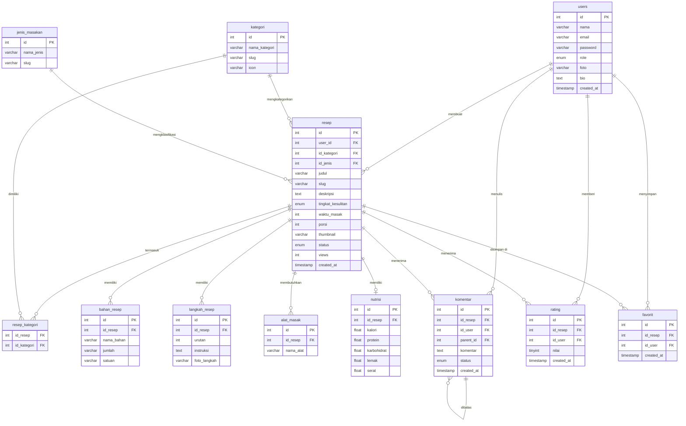

<div align="center">

# 🍳 DapurIn — Platform Resep Masakan

<p>Platform berbagi dan mengelola resep masakan berbasis <strong>PHP Native</strong> + <strong>MySQL</strong></p>

[](https://php.net)
[](https://mysql.com)
[](https://developer.mozilla.org/en-US/docs/Web/HTML)
[](https://developer.mozilla.org/en-US/docs/Web/CSS)
[](https://developer.mozilla.org/en-US/docs/Web/JavaScript)

[](LICENSE)
[]()
[](https://dapurin.free.nf)
[](https://github.com/SitiFatimahNA/Resep-Masakan)

</div>

---

## 📌 Tentang Project

**DapurIn** adalah aplikasi web full-stack yang dibangun menggunakan PHP Native tanpa framework. Platform ini memungkinkan pengguna untuk berbagi, menemukan, dan mengelola resep masakan dari berbagai kategori — mulai dari masakan sehari-hari hingga dessert istimewa.

Tampilan didesain dengan tema **hijau elegan** dan mendukung **mobile responsive** penuh — nyaman diakses dari HP maupun desktop.

> 🌐 **Live:** [dapurin.free.nf](https://dapurin.free.nf)

---

## ✨ Fitur Lengkap

<table>
<tr>
<td width="33%">

### 🌐 Publik
- Hero section modern dengan border-radius elegan
- Daftar resep + filter, pencarian, pagination
- Detail resep: bahan checklist, langkah, nutrisi, alat masak
- Kategori & jenis masakan dinamis
- Resep terpopuler (podium top 3)
- Foto profil pembuat di card resep

</td>
<td width="33%">

### 👤 User (Login)
- Tambah & edit resep (bahan, langkah, alat, nutrisi)
- Status **Publik / Draft**
- Rating bintang 1–5
- Komentar + reply bertingkat
- **Edit & hapus komentar sendiri** (AJAX)
- Simpan & hapus resep favorit (AJAX)
- Halaman resep saya & favorit
- Edit profil & foto + ganti password

</td>
<td width="33%">

### 🔧 Admin
- Dashboard + bar chart statistik 6 bulan
- Kelola resep (CRUD + toggle publik/draft)
- Kelola user (role admin/user)
- Kelola kategori & jenis masakan
- Moderasi komentar (aktif/nonaktif)
- Laporan resep + **Export CSV** + **Cetak PDF**
- Panel responsif (desktop & mobile)

</td>
</tr>
</table>

---

## 📱 Responsif Mobile

Tampilan dioptimalkan untuk semua ukuran layar dengan pendekatan **dual view**:

```
Desktop  ████████████████████  1200px+   → sidebar + tabel + grid 3 kolom
Tablet   █████████████         1024px+   → sidebar + tabel compact
Mobile   ████████              < 1024px  → hamburger menu + card layout
```

Fitur mobile:
- Navbar: search bar + tombol Masuk/Daftar proporsional
- Admin: sidebar slide-in dengan overlay
- Card resep: 2 kolom dengan info waktu di thumbnail
- Filter bar: stack vertikal, tombol full width
- Komentar: edit & hapus inline tanpa reload

---

## 🛡️ Keamanan

| Aspek | Implementasi |
|-------|-------------|
| Password | `password_hash()` + `password_verify()` bcrypt |
| Query Database | Prepared Statement `mysqli_prepare()` |
| Validasi Input | Server-side validation semua form |
| Akses Halaman | Role-based access control (admin / user) |
| Upload File | Validasi ekstensi + ukuran (maks 2MB) |
| Session | PHP session dengan role check tiap halaman |
| AJAX | Verifikasi ownership sebelum edit/hapus komentar |

---

## 🗄️ Database

**Nama:** `resep_masakan` &nbsp;|&nbsp; **Total Tabel:** 12

```
┌──────────────────┬────────────────────────────────────────────┐
│ Tabel            │ Keterangan                                 │
├──────────────────┼────────────────────────────────────────────┤
│ users            │ Data pengguna & autentikasi                │
│ kategori         │ Kategori resep (Ayam, Ikan, Sapi, dll)     │
│ jenis_masakan    │ Jenis sajian (Sarapan, Makan Siang, dll)   │
│ resep            │ Data resep utama                           │
│ resep_kategori   │ Relasi many-to-many resep ↔ kategori       │
│ bahan_resep      │ Bahan-bahan tiap resep                     │
│ langkah_resep    │ Langkah memasak + foto langkah             │
│ alat_masak       │ Daftar alat masak tiap resep               │
│ nutrisi          │ Info nutrisi per porsi (kalori, protein…)  │
│ komentar         │ Komentar + reply bertingkat (parent_id)    │
│ rating           │ Rating bintang 1–5 per user per resep      │
│ favorit          │ Resep yang disimpan user                   │
└──────────────────┴────────────────────────────────────────────┘
```

---

## 🚀 Instalasi Lokal

### Prasyarat
- [XAMPP](https://www.apachefriends.org/) (PHP 8.x + MySQL + Apache)
- [Git](https://git-scm.com/)

### Langkah

**1. Clone repository**
```bash
cd C:\xampp\htdocs
git clone https://github.com/SitiFatimahNA/Resep-Masakan.git resep-masakan
```

**2. Import database**
```
1. Buka http://localhost/phpmyadmin
2. Buat database: resep_masakan
3. Import file: config/database.sql
```

**3. Buat file koneksi** `config/koneksi.php`
```php
<?php
date_default_timezone_set('Asia/Jakarta');
$koneksi = mysqli_connect('localhost', 'root', '', 'resep_masakan');
mysqli_set_charset($koneksi, 'utf8mb4');
mysqli_query($koneksi, "SET time_zone = '+07:00'");
```

**4. Jalankan**
```
http://localhost/resep-masakan/
```

---

## 👤 Akun Demo

| Role | Email | Password |
|------|-------|----------|
| 🔴 Admin | `admin@resepmasakan.com` | `password` |
| 🟢 User | Daftar via `/register.php` | — |

---

## 📁 Struktur Folder

```
resep-masakan/
│
├── 📂 admin/                    # Panel Admin
│   ├── 📂 includes/
│   │   ├── admin-header.php     # Sidebar, topbar, CSS admin
│   │   └── admin-footer.php
│   ├── dashboard.php            # Statistik & chart
│   ├── kelola-resep.php         # CRUD resep + dual view
│   ├── kelola-user.php          # Manajemen user
│   ├── kelola-kategori.php      # CRUD kategori & jenis
│   ├── kelola-komentar.php      # Moderasi komentar
│   └── laporan.php              # Filter + Export CSV + Cetak PDF
│
├── 📂 assets/css/style.css      # Stylesheet utama (tema hijau elegan)
│
├── 📂 config/
│   ├── database.sql             # Skema database
│   └── koneksi.php              # Koneksi DB (tidak di-push ke Git)
│
├── 📂 includes/
│   ├── header.php               # Navbar responsif
│   └── footer.php               # Footer + kategori dinamis + JS global
│
├── 📂 uploads/                  # File upload user
│
├── 📂 user/                     # Fitur user login
│   ├── tambah-resep.php
│   ├── edit-resep.php
│   ├── resep-saya.php
│   ├── favorit.php
│   ├── profil.php
│   ├── ajax-favorit.php         # AJAX toggle favorit
│   └── ajax-komentar.php        # AJAX edit & hapus komentar
│
├── home.php                     # Beranda
├── resep.php                    # Daftar resep + filter
├── detail-resep.php             # Detail resep + komentar
├── kategori.php                 # Semua kategori
├── populer.php                  # Resep terpopuler
├── login.php
├── register.php
└── logout.php
```

---

## 🛠️ Tech Stack

| Layer | Teknologi |
|-------|-----------|
| **Backend** | PHP 8.x Native |
| **Database** | MySQL 8.0 + mysqli Prepared Statements |
| **Frontend** | HTML5, CSS3, JavaScript Vanilla |
| **Icon** | Font Awesome 6.5 |
| **Font** | Playfair Display + Poppins + Plus Jakarta Sans |
| **Hosting** | InfinityFree |

---

## 🗂️ ERD (Entity Relationship Diagram)



---

## 📊 Fitur Laporan Admin

- 🔍 Filter rentang tanggal & status (Publik / Draft)
- 📋 Tabel detail: judul, pembuat, kategori, views, rating, komentar
- 📥 **Export CSV** — langsung dibuka di Excel / Google Sheets
- 🖨️ **Cetak PDF** — via browser print dialog

---

<div align="center">

**Dibuat oleh Siti Fatimah Nur Az-Zahra**

© 2026 DapurIn — All rights reserved.

</div>
